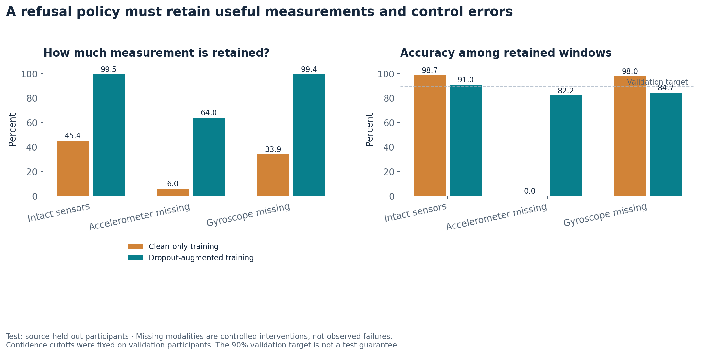
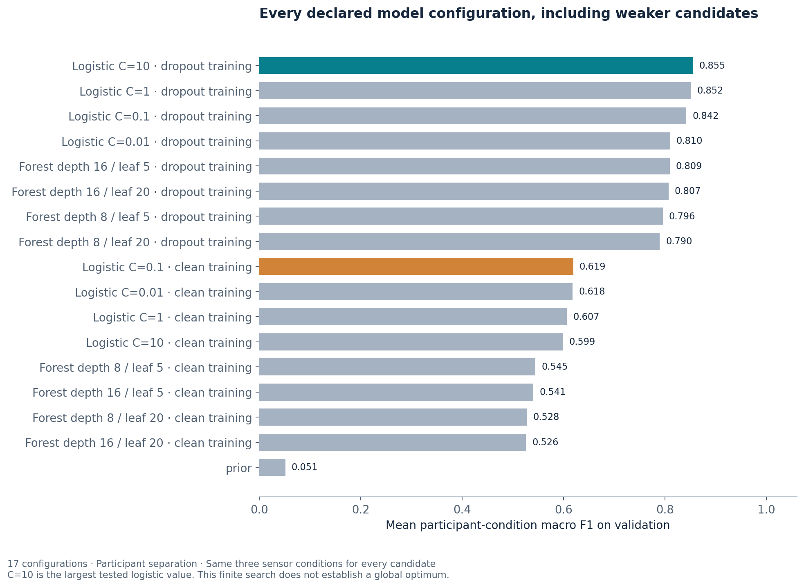
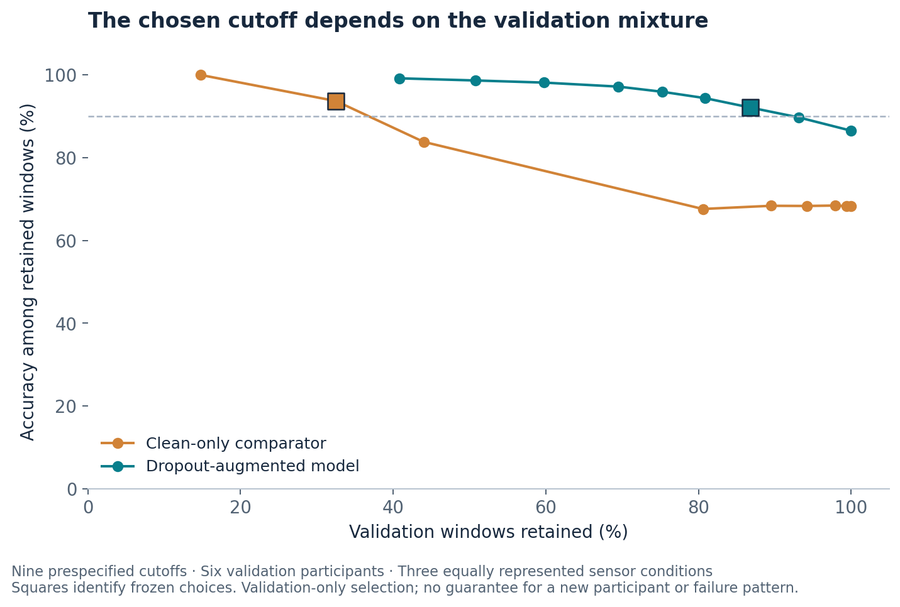
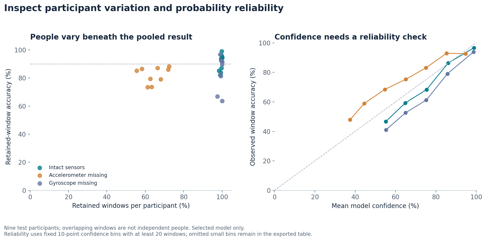

# Sensor loss and the decision to request another measurement

**Finding:** training with missing sensors improves classification and coverage on unseen participants, but a confidence cutoff that meets 90% retained-window accuracy on validation fails that target under both test sensor-loss conditions. A high-confidence subset can still be unreliable after input loss.

The practical decision is when a movement system should request another measurement. This study compares clean-only and dropout-augmented training, then tests a frozen abstention policy on people excluded from fitting and selection. The next step is a new participant cohort with condition-specific calibration and measured sensor failures.



## Data and protected split

The [UCI smartphone activity dataset](https://doi.org/10.24432/C54S4K) provides measured inertial windows and six instructed activity labels. All 10,299 source windows are retained: 5,322 from 15 fitting participants, 2,030 from six validation participants, and 2,947 from nine official-test participants. No participant crosses a split. Windows overlap by 50%, so participant blocks govern separation and uncertainty.

Forty-five window summaries describe body acceleration, total acceleration and angular velocity. Two flags identify available modalities. The **missing-sensor conditions are simulated interventions** on measured windows. Accelerometer loss removes both total and derived body acceleration; gyro loss removes angular velocity. The source's processed 2.56-second windows support an offline benchmark, with no real-time latency claim. Video and demographic records are excluded.

## Full optimization evidence

[The protocol](PROTOCOL.md) fixed the split, conditions, search and decision rule before retrieval/fitting. Seventeen candidates comprise a prior baseline, eight L2 logistic configurations and eight forests. Each model family compares clean-only and three-condition augmented training. Training weights equalize participant totals. Logistic scaling and constant-feature removal use fitting rows alone.

Selection maximizes validation macro F1 averaged over participant-condition groups. The winner is augmented logistic regression with **C=10**, the largest tested value; the best clean-only comparator has C=0.1. This is a declared finite grid, not proof of a global optimum. [Every candidate score and runtime](results/search.csv), [frozen settings and identities](results/selection.json), and validation probability exports are retained.



Confidence cutoffs 0, .4, .5, .6, .7, .8, .9, .95 and .99 were tested on validation. The rule maximizes retained coverage subject to at least 90% selective accuracy and 100 accepted windows. The selected cutoffs are 0.5 (augmented) and 0.95 (clean-only). Probability reliability is measured separately with Brier score, log loss and fixed confidence bins; threshold calibration does not establish calibrated probabilities.



## Frozen policy on unseen participants

Each condition contains the same 2,947 test windows. Selective accuracy uses only accepted windows; coverage uses all windows in that condition.

| Training | Test condition | Raw accuracy | Retained coverage | Selective accuracy |
|---|---|---:|---:|---:|
| Augmented | Intact | 90.7% | 99.5% | 91.0% |
| Augmented | Accelerometer absent | 72.2% | 64.0% | 82.2% |
| Augmented | Gyroscope absent | 84.3% | 99.4% | 84.7% |
| Clean-only | Intact | 89.0% | 45.4% | 98.7% |
| Clean-only | Accelerometer absent | 18.5% | 6.0% | 0.0% |
| Clean-only | Gyroscope absent | 79.8% | 33.9% | 98.0% |

The clean-only policy accepts 178 accelerometer-missing windows and classifies every accepted window incorrectly. Confidence alone does not reliably detect that input failure. Augmentation improves raw accuracy in every tested condition and retains much more data, but its fixed rule also misses the validation reliability target when sensors are absent.

The augmented model's multiclass Brier scores are 0.137 intact, 0.409 without acceleration and 0.229 without gyro. Brier is the mean **sum** of squared errors across six class probabilities, not a per-class average. Full macro F1, balanced accuracy, Brier, log loss, denominators and selective outcomes are in [test metrics](results/test_metrics.csv).

Across the controlled three-condition mixture, paired 2,000-draw participant-block bootstrap intervals are +17.1 to +23.0 percentage points for raw-accuracy improvement, +55.7 to +62.1 points for coverage improvement and +45.4 to +53.5 points for accepted-correct fraction. These are conditional on nine sampled participants, not population/device uncertainty or a natural failure mix. Both sensors missing forces abstention regardless of confidence.



## Independent checks and reproduction

```sh
python -m pip install -r requirements.txt
python -m unittest discover -s tests -v
python src/verify.py test
python src/check_reproduction.py
```

The verifier imports no fitting/metric helpers. It independently recomputes all successful candidate metrics, selection, threshold outcomes, test scores and participant-block intervals from exported probabilities. All 24 source-file hashes and all row identities reconcile; feature arithmetic is independently spot checked at 14 fixed boundary/interior windows per source partition. Five contract tests cover modality lineage, absent-input refusal, equal participant weights and threshold boundaries. The offline replay refits all candidates in a disposable folder and compares frozen settings and test outcomes.

Two corrections are retained in [the evidence history](results/corrections): a constant-column scaling warning was repaired before testing; the first test-score export failed while merging duplicate count fields. The repaired export scores the **same retained predictions**, without changing a model or threshold. Its original prediction hash is retained. This is a repaired computation of the committed evaluation, not a new independent test.

## Boundaries and reuse

The study uses one historical smartphone setup, instructed activities and a small participant sample. Controlled sensor masking does not reproduce hardware faults, timing interruptions or new tasks. No clinical validation, production deployment, new algorithm or exhaustive novelty claim is made. The original recognition benchmark and preprocessing come from Anguita and colleagues; attribution and [CC BY 4.0 reuse details](SOURCES.md) accompany the source files.

This is independent, AI-assisted research. Manuscript drafts remain private and outside Git history. Public code, licensed source excerpts, predictions, figures and checks provide the inspectable portfolio evidence.
